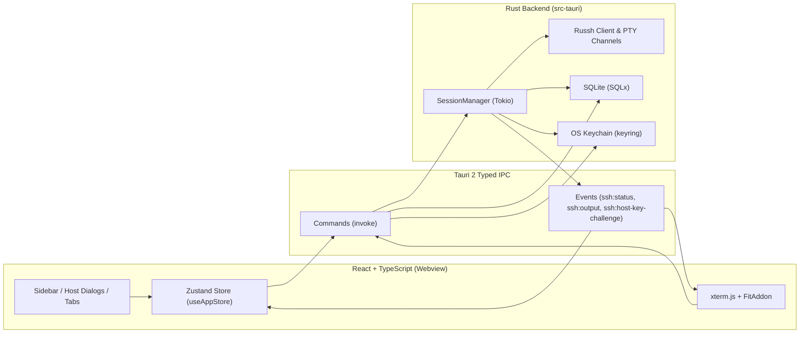
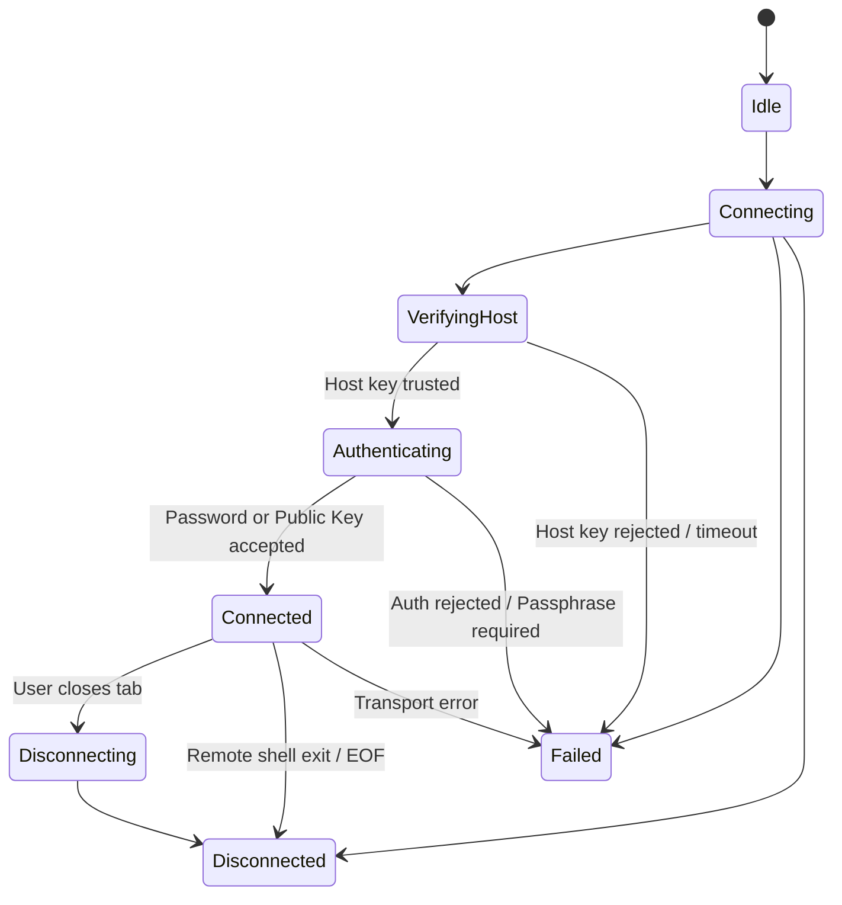

# NexTerm Architecture

## 1. High-Level Overview

NexTerm follows a strict separation of responsibilities between the **React/TypeScript Frontend** (presentation, user interaction, xterm.js rendering) and the **Rust Backend** (SSH protocol engine, cryptographic host key verification, OS credential storage, SQLite persistence).

---

## 2. Backend Module Structure (`src-tauri/src/`)

- [`models.rs`](../src-tauri/src/models.rs): Strongly typed domain structures (`Host`, `HostGroup`, `KnownHost`, `SessionInfo`, `SessionState`, `AppSettings`) and IPC event payloads. Enforces explicit state machine transitions via `SessionState::can_transition_to`.
- [`error.rs`](../src-tauri/src/error.rs): Unified `AppError` enum serialized into structured `{ code, message }` payloads for deterministic frontend handling without leaking sensitive material.
- [`validation.rs`](../src-tauri/src/validation.rs): RFC-1123 hostname validation, IPv4/IPv6 parsing, port bounds (`1..=65535`), private key path sanity checks, and PTY dimension bounds (`10..=1000` cols, `2..=500` rows).
- [`db.rs`](../src-tauri/src/db.rs): SQLite connection pool (`sqlx::SqlitePool`), automatic startup schema migration (`migrations/0001_init.sql`), and parameterized queries for `hosts`, `host_groups`, `known_hosts`, and `settings`.
- [`credentials.rs`](../src-tauri/src/credentials.rs): `CredentialStore` trait with `OsCredentialStore` (backed by OS-native Credential Manager / Keychain / Secret Service) and `MemoryCredentialStore` (for isolated automated testing). Uses `zeroize::Zeroizing` for sensitive strings in memory.
- [`ssh.rs`](../src-tauri/src/ssh.rs): Asynchronous `SessionManager` and `SshClientHandler` implementing `russh::client::Handler`. Manages session lifecycles, interactive host key verification via `tokio::sync::oneshot`, bounded `mpsc` input/resize queues, and chunked base64 output emission.
- [`commands.rs`](../src-tauri/src/commands.rs): Thin Tauri `#[tauri::command]` handlers delegating business logic to `Database`, `CredentialStore`, and `SessionManager`.

---

## 3. SSH Session Lifecycle State Machine

Every SSH session managed by `SessionManager` transitions explicitly through the following states:

---

## 4. Frontend Module Structure (`src/`)

- [`types/models.ts`](../src/types/models.ts): TypeScript interfaces synchronized with Rust `serde` structs.
- [`lib/ipc.ts`](../src/lib/ipc.ts): Typed wrapper around `@tauri-apps/api/core` (`invoke`) and `@tauri-apps/api/event` (`listen`).
- [`lib/validation.ts`](../src/lib/validation.ts): Zod schemas (`hostInputSchema`, `appSettingsSchema`) for immediate client-side validation.
- [`store/useAppStore.ts`](../src/store/useAppStore.ts): Zustand state store managing hosts, groups, multi-tab sessions, pending host key challenges, and authentication prompts.
- [`components/TerminalPane.tsx`](../src/components/TerminalPane.tsx): Manages per-tab `Terminal` (`@xterm/xterm`) instances, `FitAddon` + `ResizeObserver` synchronization, search bar (`@xterm/addon-search`), and binary-safe base64 I/O.

